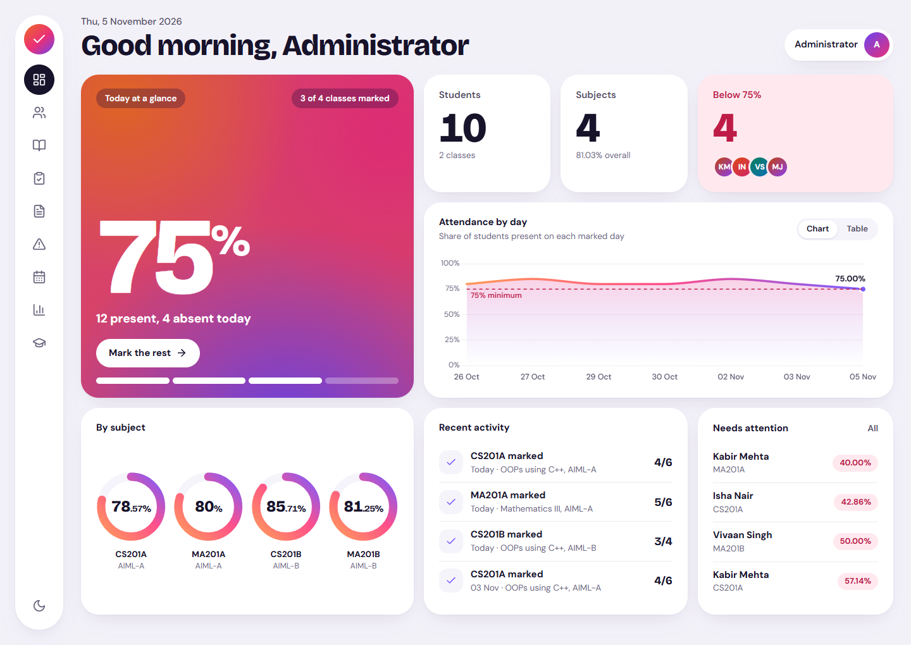
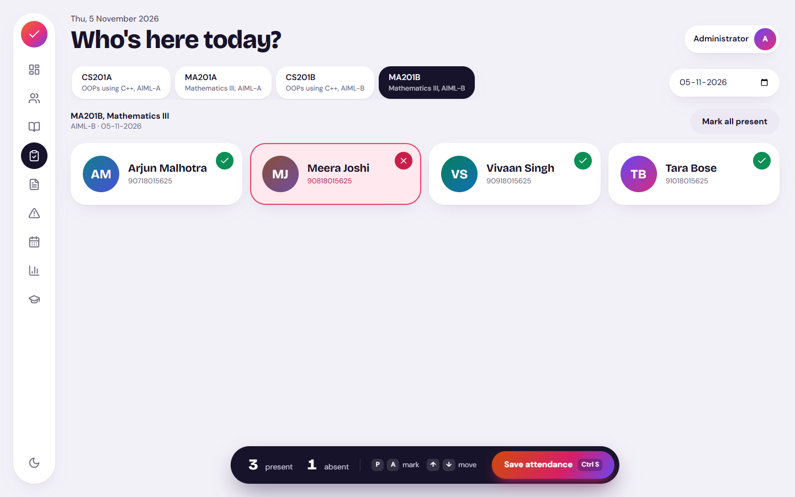
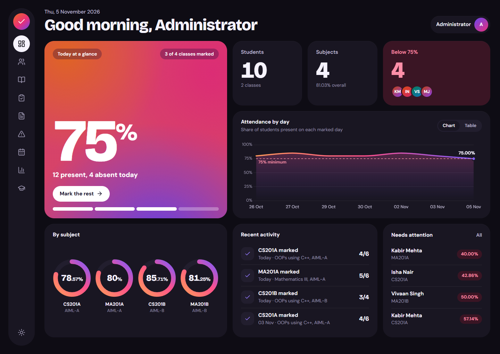
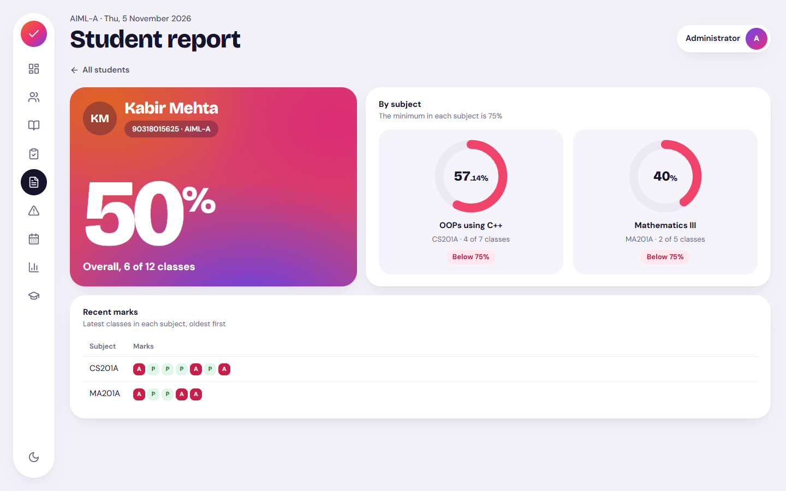
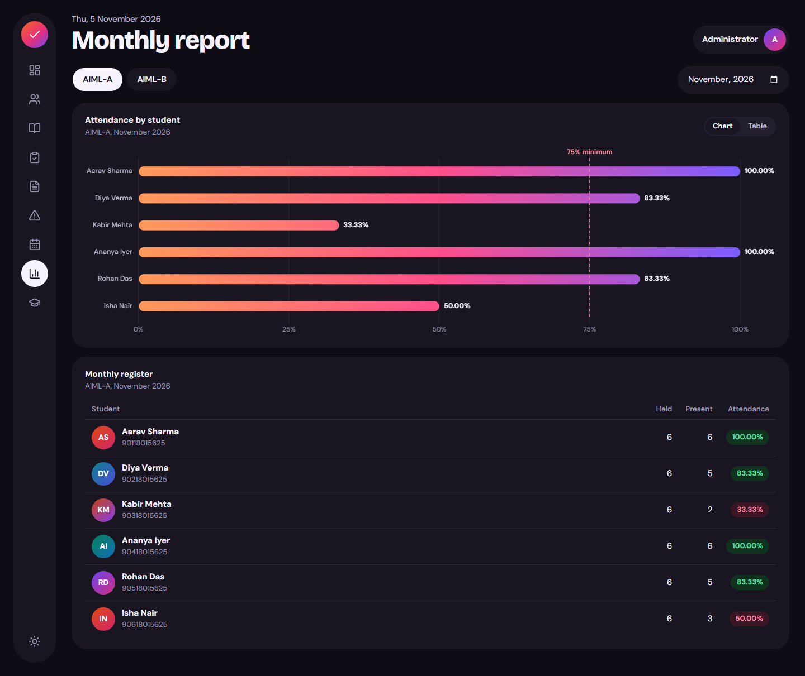
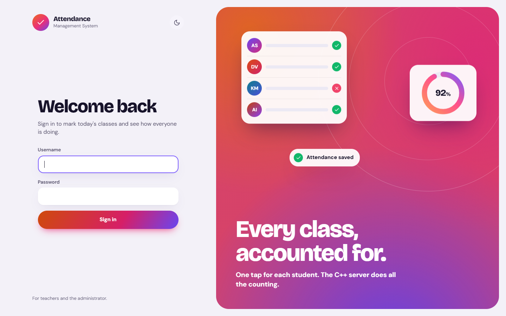
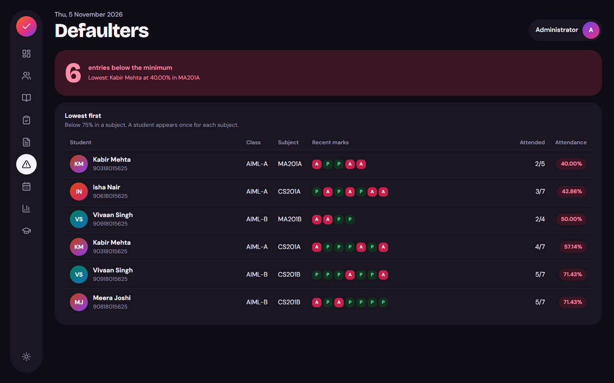

# Attendance Management System

An attendance system for a school or college, written in C++. It has two front ends that share the same core classes:

- a **terminal version**: a menu-driven console program
- a **web version**: a C++ HTTP server with a browser interface

Teachers log in, manage students and subjects, mark attendance by date and subject, and see percentages, a defaulter list, and daily and monthly reports. All data is stored in text files, so it stays between runs. All logic stays in C++, and the browser only sends requests and shows the replies.

Built for the **OOPs using C++ Lab** (PBL), 3rd Semester, B.Tech CSE (AIML).



## Architecture

```
  Browser
     |
     |  downloads the page              sends requests, with a token in a header
     v                                       |
  Vercel (web/: HTML, CSS, JS)               |
                                             v
                                  Render (C++ server in Docker)
                                             |
                                             v
                                  Core C++ classes -> data/*.txt
```

The frontend is a static site. The C++ server holds all the logic and data, and answers with JSON. Because they are on different sites, the server uses CORS to say which site may call it. The Render address also serves the same frontend by itself, as a fallback.

## Team

| Member | Module |
|--------|--------|
| Aksh Rastogi | Core system, login, menus |
| Vaibhav | Students |
| Akshay Kumar | Subjects and attendance marking |
| Srishti Gupta | File handling and validation |
| Dhruv Kataria | Reports and testing |

## Features

- Login for admin and teachers, checked against a file, with three attempts
- Add, view, search, update, and delete students
- Real roll/enrollment numbers, with duplicates rejected
- Add and view subjects for each class
- Mark attendance by subject and date, and correct a wrong mark
- Student report with percentage per subject and overall
- Defaulter list of students below 75% in a subject
- Daily and monthly attendance reports
- Every change is saved to file immediately

The web version adds:

- A dashboard with today at a glance, gradient rings and charts, recent activity, and the students who need attention
- Fast marking: tap a student tile on a phone, or use keyboard shortcuts on a laptop
- Search and sort, done by the C++ server
- A REST API with JSON, and login sessions with tokens
- Light and dark themes, with layouts designed for phones and laptops

## How to compile and run

Run both programs from the project folder, because they read their files from `data/`. Do not run them at the same time, because whichever saves last would overwrite the other's changes.

### Terminal version

You need g++ with C++11 support. It uses no external libraries.

```
g++ -std=c++11 -Wall -Wextra -Iinclude -Iconsole main.cpp console/*.cpp src/*.cpp -o attendance.exe
.\attendance.exe
```

### Web version

The server needs `std::thread`, so it needs a 64-bit compiler. MinGW g++ 6.3 cannot build it. Install [MSYS2](https://www.msys2.org), then run `pacman -S --needed mingw-w64-x86_64-gcc` in the MSYS2 terminal.

In PowerShell, from the project folder:

```
$env:Path = "C:\msys64\mingw64\bin;" + $env:Path
g++ -std=c++11 -Wall -Wextra -D_WIN32_WINNT=0x0A00 -Iinclude -Iserver -Ithird_party server/*.cpp src/*.cpp -static -lws2_32 -o attendance_server.exe
.\attendance_server.exe
```

Then open <http://localhost:8080>. The build takes a minute or two. The charts and fonts load from the internet. Without it, the tables still work.

Locally the server only accepts connections from your own computer. `web/js/config.js` leaves `API_BASE` empty, so the page talks to the server that served it.

**Sample logins**

| Username | Password | Role |
|----------|----------|------|
| `admin` | `admin123` | Admin (can also add and view teachers) |
| `teacher1` | `pass123` | Teacher |

The sample data contains 10 fictional students in two classes, 4 subjects, and 6 days of attendance from 26-10-2026 to 03-11-2026.

## Sample output

Logging in:

```
======================================
    ATTENDANCE MANAGEMENT SYSTEM
======================================
Username: admin
Password: admin123

Welcome, Administrator!

========== MAIN MENU ==========
1. Student Management
2. Subject Management
3. Attendance
4. Reports
5. Account
0. Exit
Enter choice:
```

Student attendance (Attendance > View student attendance, roll number `90218015625`):

```
Name    : Diya Verma
Roll No : 90218015625
Class   : AIML-A

Code        Subject                                   Present  Total  Percentage      Status
------------------------------------------------------------------------------------------------
CS201A      OOPs using C++                            5        6      83.33%          OK
MA201A      Mathematics III                           3        4      75.00%          OK
------------------------------------------------------------------------------------------------
Overall                                               8        10     80.00%
```

Defaulter list (Reports > Defaulter list):

```
Students below 75% in a subject

Roll No          Name                          Class     Subject     Attended  Percentage
-----------------------------------------------------------------------------------------
90318015625      Kabir Mehta                   AIML-A    CS201A      4/6       66.67%
90318015625      Kabir Mehta                   AIML-A    MA201A      2/4       50.00%
90618015625      Isha Nair                     AIML-A    CS201A      3/6       50.00%
90818015625      Meera Joshi                   AIML-B    CS201B      4/6       66.67%
90918015625      Vivaan Singh                  AIML-B    MA201B      2/4       50.00%
Total entries: 5
```

## Screenshots

| Light | Dark |
|-------|------|
|  |  |
|  |  |
|  |  |

## Concepts used

| Concept | Where |
|---------|-------|
| Classes and objects | The core: `Date`, `AttendanceRecord`, `Person`, `Student`, `Teacher`, `Subject`, `FileManager`, `Report`, `AttendanceSystem`, `Result`. The terminal: `ConsoleUI`, `ReportPrinter`. The server: `ApiServer`, `JsonMapper`, `SessionManager`, `Session`. |
| Encapsulation | Private data with getters and setters. `Teacher::password` is only compared inside `checkLogin()`. |
| Arrays | `students[]`, `subjects[]`, and `teachers[]` in `AttendanceSystem`, each student's `records[]` attendance array, and `sessions[]` in `SessionManager` |
| Static members | `totalStudents`, `nextId`, `getCount()`, `generateId()`, `calcPercentage()`, `DEFAULTER_LIMIT` |
| File handling | `ifstream` to read, `ofstream` to rewrite, and `ios::app` to append |
| Inheritance | `Person` -> `Student` and `Teacher` |
| Function overloading | `searchStudent(int)` and `searchStudent(string)`, and `countPresent()` in three forms |
| Runtime polymorphism | Virtual `display()`, called through `showPerson(const Person&)` |
| Sorting | Selection sort in `listStudents()` and `sortByPercentage()`, and insertion sort in `markHistory()` |
| Client-server, REST, JSON | The browser sends HTTP requests to `ApiServer`, which answers with JSON |
| Threads | The server handles requests on several threads, and a `std::mutex` protects the shared data |

## Project structure

```
main.cpp       Terminal entry and menus
console/       Terminal prompts and printing
include/       Core header files, one per class
src/           Core source files, one per class
server/        Web server: routes, sessions, and JSON
web/           The browser pages: HTML, CSS, and JavaScript
third_party/   cpp-httplib and nlohmann/json, with their licences
data/          students.txt, subjects.txt, teachers.txt, attendance.txt
tests/         Automated tests for the terminal, the API, and the browser
Dockerfile     Builds the server for deployment
render.yaml    Settings for Render
vercel.json    Settings for Vercel
```

## Data files

Plain text, one record per line, fields separated by `|`.

| File | Format |
|------|--------|
| `students.txt` | `id\|rollNo\|name\|className` |
| `subjects.txt` | `code\|name\|className` |
| `teachers.txt` | `id\|name\|username\|password` |
| `attendance.txt` | `studentId\|subjectCode\|DD-MM-YYYY\|status` |

## Testing

```
python tests/run_golden.py attendance.exe
python tests/api_test.py attendance_server.exe attendance.exe
```

`run_golden.py` compares the terminal program against recorded sessions. `api_test.py` sends real HTTP requests, and works out the expected report numbers directly from the data files. `tests/browser/` drives the site in Chrome, including with the frontend and the API on different ports, and with a simulated sleeping server. Every test runs on a copy of the data.

## Deployment

The API runs on Render, and the frontend on Vercel. Do Render first, because Vercel needs its address.

### 1. Render (the C++ API)

1. Go to <https://render.com>, choose **New > Blueprint**, and connect this repository. Render reads `render.yaml`.
2. Enter the two values it asks for, from the table below. Use a temporary `ALLOWED_ORIGIN` for now if you do not know the Vercel address yet.
3. Check that the plan says Free, then deploy.
4. Open `https://<your-service>.onrender.com/api/health`. It should show `{"status":"ok"}`.

If your address is not `https://attendance-register.onrender.com`, change `RENDER_API` in `web/js/config.js` and the same address in `vercel.json`, then push.

### 2. Vercel (the frontend)

1. Go to <https://vercel.com>, choose **Add New > Project**, and import this repository.
2. Leave the Root Directory as it is. `vercel.json` sets the rest, and there is no build step.
3. Deploy, and copy the address it gives you.

### 3. Connect them

On Render, set `ALLOWED_ORIGIN` to the Vercel address, with no slash at the end. Render restarts the service. Then open the Vercel address and log in.

### Environment variables

These are set on Render. Vercel needs none.

| Variable | Example | Meaning |
|----------|---------|---------|
| `PORT` | `10000` | The port to listen on. Render sets this itself. The default is `8080`. |
| `HOST` | `0.0.0.0` | The address to listen on. The Dockerfile sets this. The default is `127.0.0.1`, this computer only. |
| `ALLOWED_ORIGIN` | `https://oops-pbl.vercel.app` | The sites that may call the API from a browser, separated by commas. The default is none. |
| `DEMO_PASSWORD` | a secret of your own | Replaces every account's password at startup, because the sample passwords are public in this repository. 4 to 20 characters, with no spaces or `\|`. |

### Free-tier notes

- **Data resets.** Render's free plan has no permanent disk. Every restart, redeploy, or sleep throws away all changes, and the server starts again from the sample data in `data/`. Only use fictional data online.
- **Cold starts.** The free server sleeps after 15 quiet minutes and takes about a minute to wake. The site shows a "Waking up the server" message and retries by itself. A save is never repeated automatically, because the first try may have reached the server. The site asks you to save again.

## Limitations

- Passwords are stored as plain text, so the deployed site uses a secret `DEMO_PASSWORD`.
- Fixed limits: 100 students, 20 subjects, 10 teachers, and 300 attendance records per student.
- One lecture per subject per date.
- The terminal version is for one user at a time. The server handles requests one at a time behind a mutex.
- The server keeps all sessions in memory, so a restart logs everyone out.

## Documentation

- [PLAN.md](PLAN.md): objectives, scope, and where each concept is used
- [DESIGN.md](DESIGN.md): classes, file formats, menu flow, and validation rules
- [TASKS.md](TASKS.md): build checkpoints, module ownership, and test checklist
- [VIVA.md](VIVA.md): viva questions and answers
- [WEB_PLAN.md](WEB_PLAN.md): the web version's architecture, API, design system, and deployment
